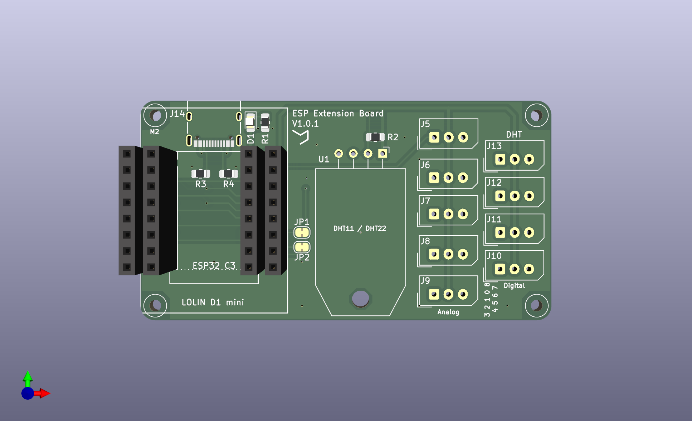
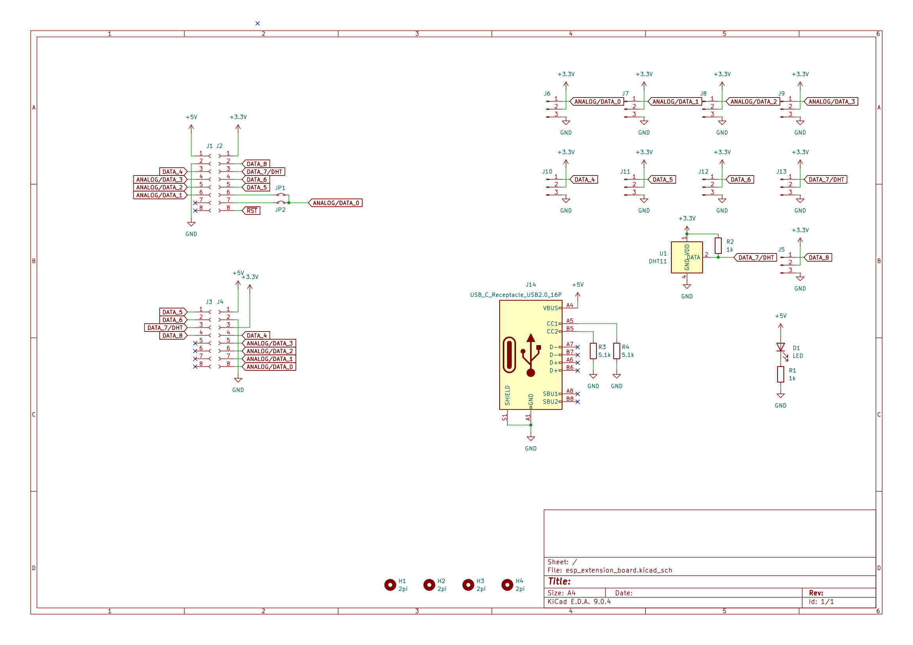

# ESP Extension Board

- IOT Extension board for `LOLIN D1 mini`(ES8266) / `ESP32C3 SuperMini`
- Tool : Kicad 9.0
# Pinout

|  Connector   | ESP8266 | ESP32C3 |
|--------------|---------|---------|
| 0 (J6)       | GPIO16  | GPIO0   |
| 1 (J7)       | GPIO5   | GPIO1   |
| 2 (J8)       | GPIO4   | GPIO2   |
| 3 (J9)       | GPIO0   | GPIO3   |
| 4 (J10)      | GPIO2   | GPIO4   |
| 5 (J11)      | GPIO14  | GPIO5   |
| 6 (J12)      | GPIO12  | GPIO6   |
| 7 (J13, DHT) | GPIO13  | GPIO7   |
| 8 (J5)       | GPIO15  | GPIO8   |

# schematics

# PCB
